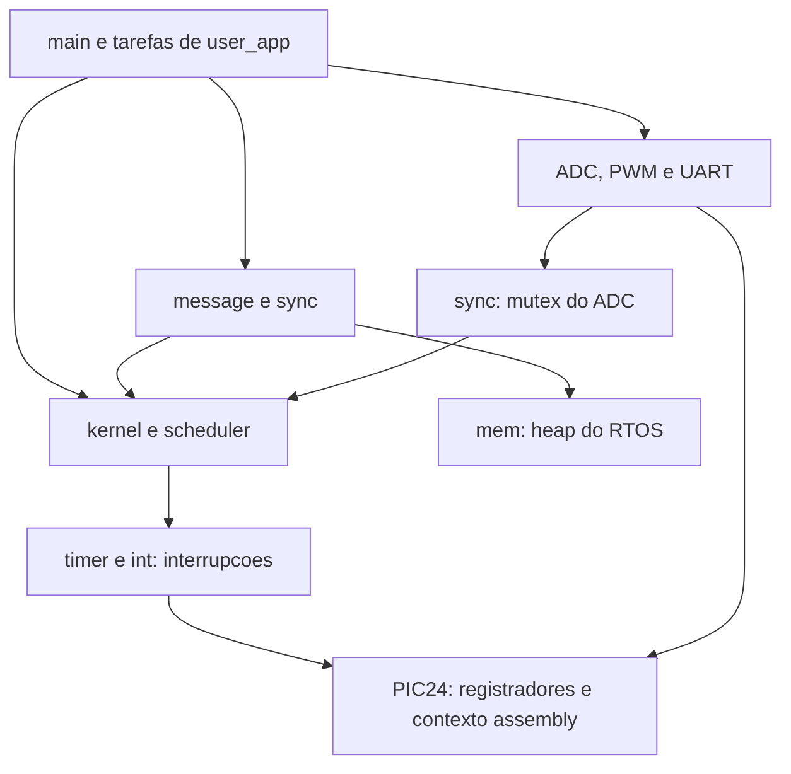
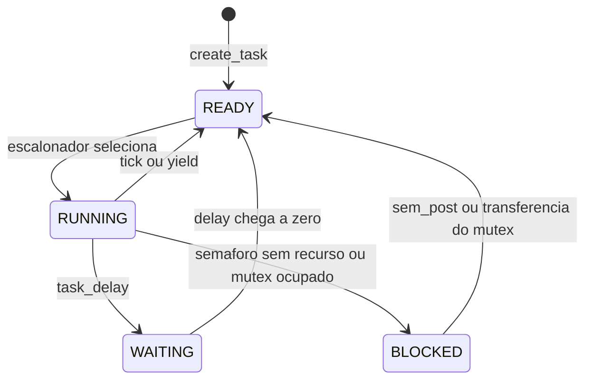

# Operação manual e arquitetura do projeto

Guia para analisar e operar a solução da branch `feat/primeiro-trabalho`. Informações de compatibilidade consultadas em **21/10/2026**. Para ligações dos periféricos e o roteiro completo de apresentação, consulte [primeiro-trabalho.md](primeiro-trabalho.md).

## 1. Posso usar a extensão PlatformIO do VS Code?

Você pode continuar usando o VS Code com a extensão instalada. Para este firmware, o fluxo configurado é **VS Code + tarefas + make + XC16**.

O catálogo oficial do PlatformIO consultado lista Microchip PIC32, mas não uma plataforma oficial PIC24/XC16 para o PIC24FJ128GA010. A plataforma `microchippic32` usa outra arquitetura e toolchain; selecioná-la não compila este RTOS. Veja o [catálogo de plataformas](https://docs.platformio.org/en/latest/platforms/index.html) e a [plataforma Microchip PIC32](https://docs.platformio.org/en/latest/platforms/microchippic32.html).

É tecnicamente possível desenvolver uma plataforma personalizada para chamar o XC16, conforme a possibilidade de extensão descrita no catálogo. Isso exige integrar compilação, dispositivo e eventuais operações de gravação/depuração. Essa adaptação não está implementada nesta branch. Não há `platformio.ini`, e os botões Build/Upload do PlatformIO não são o comando de build deste projeto.

Para trabalhar agora:

1. Abra a pasta **DEC7562** no VS Code.
2. Edite os fontes de `AdidOS.X/`.
3. Use as tarefas de `.vscode/tasks.json` ou os comandos de terminal da seção 4.
4. Gere o HEX com o XC16 e carregue-o no Proteus ou grave-o no PIC24.

A preferência local `cmake.sourceDirectory` que apontava para `FreeRTOS/` foi preservada em um stash nomeado. Ela seleciona outro projeto do repositório. O build desta solução é comandado pelos makefiles de `tests/` e `AdidOS.X/Makefile.pic24`; configurar CMake para `FreeRTOS/` não compila o AdidOS.

## 2. Posso testar no Proteus dentro de uma VM?

O **PIC24FJ128GA010 é um dispositivo suportado pelo Proteus VSM**. A documentação da família lista o modelo e a simulação de interrupções, ADC, PWM e UART, que são os recursos usados aqui. Consulte a [lista oficial PIC24](https://www.labcenter.com/documents/?313=).

Uma VM com **Windows x64** é uma opção de ambiente a avaliar, desde que a versão do Proteus e seus módulos funcionem nessa VM. É necessário ter o VSM para a família PIC24; somente o editor de esquemas não executa o firmware. A VM não altera o processador alvo: o software do Windows continua simulando um PIC24 de 16 bits.

### Particularidade deste Mac

O host desta execução é **macOS arm64**. A [FAQ oficial da Labcenter](https://www.labcenter.com/faq/) exige processador Intel/AMD x64 e informa que processadores ARM não são suportados. Portanto, **Windows ARM em uma VM neste Mac não é uma configuração oficialmente suportada para o Proteus**, mesmo que alguma versão consiga iniciar por emulação de aplicativos.

Como consequência prática, um computador/laboratório Windows x64 é o caminho mais previsível para a demonstração. Uma VM que emule um PC x64 completo é uma possibilidade experimental, com desempenho e compatibilidade a verificar. Não foi testada nesta execução; ter uma VM instalada não confirma que o Proteus funcionará nela.

### Fluxo manual da simulação

1. No ambiente escolhido, confira se o Proteus abre e se o componente `PIC24FJ128GA010` possui modelo VSM disponível.
2. Compile o firmware com o XC16. Você pode compilar fora da VM e copiar o HEX, ou compilar dentro dela com MPLAB X/XC16.
3. Copie para o Windows o circuito `AdidOS.X/Proteus/Simulacao.pdsprj` e o **HEX novo** de `AdidOS.X/dist/primeiro-trabalho/AdidOS.hex`. Preserve os arquivos associados ao projeto Proteus, quando houver.
4. Abra o circuito e adapte-o às conexões do [guia do trabalho](primeiro-trabalho.md#montagem-e-periféricos): AN0/RB0, OC1/RD0, UART/RF3, LEDs e alimentação.
5. Nas propriedades do PIC24, selecione o novo arquivo em **Program File** e ajuste o clock para **8 MHz**. O firmware usa FCY=4 MHz.
6. Configure o terminal virtual para **9600 baud, 8 bits, sem paridade, 1 stop bit**.
7. Use os controles **Play**, **Pause** e **Stop** da simulação. Depois de modificar e recompilar o código, pare a simulação, atualize o HEX e reinicie para repetir o boot.
8. Confira mensagens de herança/restauração, leitura do potenciômetro e duty no osciloscópio. Siga o roteiro de demonstração do guia.

Use caminhos existentes **dentro do Windows** no campo Program File; um caminho `/Users/...` do macOS não é automaticamente um caminho válido na VM. Uma pasta compartilhada ou cópia manual resolve a transferência. Para depuração com símbolos, o build também produz ELF; a disponibilidade de depuração C e o mapeamento dos fontes dependem da combinação Proteus/XC16. O HEX é o ponto de partida para executar a simulação.

Atalhos de depuração do Proteus variam com a versão e configuração. Consulte o menu **Debug** da instalação e seus atalhos exibidos; este guia usa os controles nomeados para evitar atribuir teclas de outra versão. A Labcenter mantém [tutoriais de XC16, debug e janelas de observação](https://www.labcenter.com/tutorials/).

O tempo de simulação pode avançar mais lentamente que o relógio do computador, especialmente sob emulação. Compare ticks e sinais no tempo simulado; não interprete lentidão da interface da VM como duração de um tick do RTOS.

## 3. Atalhos e tarefas do VS Code

As tarefas estão versionadas em [`.vscode/tasks.json`](../.vscode/tasks.json). Elas invocam `make` com diretório de trabalho explícito e não dependem do PlatformIO.

| Operação | macOS | Windows/Linux | Efeito neste projeto |
| --- | --- | --- | --- |
| Salvar arquivo | `Cmd+S` | `Ctrl+S` | Salva a alteração antes de testar/compilar |
| Paleta de comandos | `Cmd+Shift+P` | `Ctrl+Shift+P` | Permite selecionar `Tasks: Run Task` |
| Executar tarefa padrão de build | `Cmd+Shift+B` | `Ctrl+Shift+B` | Executa **RTOS: testes locais** |
| Abrir arquivo pelo nome | `Cmd+P` | `Ctrl+P` | Acesso rápido a `main.c`, `sync.c`, etc. |
| Buscar no projeto | `Cmd+Shift+F` | `Ctrl+Shift+F` | Localiza funções e referências |
| Configurar atalhos | `Cmd+K`, depois `Cmd+S` | `Ctrl+K`, depois `Ctrl+S` | Inspeciona conflitos e permite personalização |

Os atalhos são os padrões do VS Code e podem mudar por extensão, teclado ou personalização. Referências: [atalhos padrão](https://code.visualstudio.com/docs/reference/default-keybindings) e [configuração de teclas](https://code.visualstudio.com/docs/configure/keybindings).

Para abrir o terminal, use **Terminal > New Terminal** ou procure `Terminal: Create New Terminal` na paleta. Para escolher outra tarefa, abra a paleta, execute `Tasks: Run Task` e selecione:

| Tarefa | O que executa | Dependências |
| --- | --- | --- |
| `RTOS: testes locais` | Três testes e verificação de sintaxe | make e compilador C do host com ASan/UBSan |
| `RTOS: compilar PIC24 (XC16)` | Compila, linka e gera HEX | make, ferramentas de shell e XC16 no PATH |
| `RTOS: limpar testes` | Remove executáveis locais dos testes | make |
| `RTOS: limpar firmware` | Remove os diretórios de build/output desta solução | make e ferramentas de shell |

**F5 não está configurado para depurar o PIC24 neste workspace.** Um breakpoint no VS Code não controla automaticamente o processador simulado no Proteus. A depuração do firmware precisa de uma sessão compatível no Proteus/MPLAB; não foi criado um `launch.json` que prometa essa integração.

As tarefas são atalhos para os mesmos comandos do terminal. Elas não instalam compiladores, não configuram a VM e não gravam automaticamente o microcontrolador. Veja a [documentação oficial de tarefas](https://code.visualstudio.com/docs/debugtest/tasks).

## 4. Como funcionam make e build?

`make` lê regras de um makefile, verifica dependências e executa ferramentas. O compilador transforma cada `.c` em `.o`; o linker reúne os objetos em um programa; a conversão final produz o HEX para o PIC24.

Há **dois builds distintos** nesta solução:

| Fluxo | Makefile | Compilador | Produto | Onde executa |
| --- | --- | --- | --- | --- |
| Testes locais | `tests/Makefile` | `cc`, Clang ou GCC do computador | `test_rtos`, `test_io`, `test_demo` | macOS/Linux compatível com os sanitizadores |
| Firmware | `AdidOS.X/Makefile.pic24` | `xc16-gcc` | ELF, MAP e HEX do PIC24 | Ambiente com XC16 e suporte ao dispositivo |

### Comandos a partir da raiz DEC7562

```sh
# Testar a logica e verificar a sintaxe da aplicacao.
make -C tests test syntax

# Compilar o firmware para o PIC24.
make -C AdidOS.X -f Makefile.pic24

# Ver os comandos que seriam executados, sem gerar o firmware.
make -C AdidOS.X -f Makefile.pic24 -n

# Remover os executaveis dos testes.
make -C tests clean

# Remover somente build/primeiro-trabalho e dist/primeiro-trabalho.
make -C AdidOS.X -f Makefile.pic24 clean
```

`-C` muda para o diretório indicado; `-f` escolhe o makefile; `-n` apenas mostra os comandos. O makefile PIC24 inclui arquivos `.d` gerados pelo compilador para reconstruir objetos afetados por alterações em headers. Nos testes, alterações nos fontes/headers fazem o executável correspondente ser recompilado; o alvo `test` sempre executa os testes.

Para informar ferramentas fora do PATH:

```sh
make -C AdidOS.X -f Makefile.pic24 \
  XC16_CC=/caminho/xc16/bin/xc16-gcc \
  XC16_BIN2HEX=/caminho/xc16/bin/xc16-bin2hex
```

Se necessário, acrescente `DFP_DIR=/caminho/PIC24F-GA-GB_DFP/versao`. Para as tarefas do VS Code, ajuste o PATH antes de iniciar o editor ou acrescente esses argumentos à tarefa de compilação na sua instalação.

No Windows, o makefile portátil usa comandos de shell como `mkdir -p` e `rm`; ele requer um ambiente compatível, como um shell POSIX com GNU make. Um PowerShell isolado não fornece essas ferramentas. A alternativa pela IDE é abrir `AdidOS.X` no MPLAB X, selecionar XC16/dispositivo e regenerar os makefiles para aquela instalação.

### Fluxo dos arquivos

```text
AdidOS.X/*.c + headers
  -> xc16-gcc: compilacao de cada modulo
  -> AdidOS.X/build/primeiro-trabalho/*.o e *.d
  -> xc16-gcc/linker: AdidOS.elf e AdidOS.map
  -> xc16-bin2hex: AdidOS.hex
  -> Proteus VSM ou gravacao no PIC24
```

Todos os produtos finais ficam em `AdidOS.X/dist/primeiro-trabalho/`. O **ELF** contém o programa e informações de depuração; o **MAP** descreve a disposição de memória; o **HEX** é a imagem para carga/gravação. O alvo `clean` não apaga os fontes nem os binários históricos de `dist/default/production/`.

### Qual makefile devo escolher?

- Use **`tests/Makefile`** para os testes do computador.
- Use **`AdidOS.X/Makefile.pic24`** para a compilação portátil desta solução.
- **`AdidOS.X/Makefile` + `nbproject/`** pertencem ao fluxo gerado pelo MPLAB X. O arquivo local original contém caminhos Windows e deve ser regenerado pela IDE para o seu ambiente. Não altere os makefiles gerados como ponto principal de manutenção.
- **`FreeRTOS/`** é outro material do repositório. Ele não é dependência do AdidOS e não entra na lista de fontes desta aplicação.

## 5. Como funciona a arquitetura?

### Organização dos diretórios

```text
DEC7562/
├── AdidOS.X/                  RTOS PIC24 e aplicacao do trabalho
│   ├── main.c                 configuracao, criacao das tarefas e partida
│   ├── user_app.c/.h          quatro tarefas e indicadores da demonstracao
│   ├── kernel.c/.h            TCBs, pilhas, estados, yield, delay e contexto
│   ├── scheduler.c/.h         prioridade, Round-Robin e trace circular
│   ├── sync.c/.h              semaforos, mutexes e heranca de prioridade
│   ├── message.c/.h           fila circular bloqueante
│   ├── mem.c/.h               heap, alocacao/liberacao e juncao de blocos
│   ├── adc.c/.h               driver ADC1
│   ├── pwm.c/.h               driver OC1/Timer2
│   ├── uart.c/.h              driver de saida serial
│   ├── int.c/.h               interrupcao de troca de contexto
│   ├── timer.c/.h             tick do sistema e liberacao de delays
│   ├── platform.h             secoes criticas e adaptacao para testes
│   ├── types.h, os_config.h   tipos e configuracoes
│   ├── nbproject/             configuracao MPLAB X
│   ├── Proteus/               circuito original das aulas
│   └── Makefile.pic24         build portatil do firmware
├── tests/                     testes e registradores simulados do host
├── docs/                      guias de uso e demonstracao
├── .vscode/tasks.json         atalhos para chamar make
├── Aula_*/                    exemplos anteriores das aulas
└── FreeRTOS/                  material independente do AdidOS
```

### Camadas e dependências



O kernel não depende do FreeRTOS. `os_config` chama a configuração da aplicação, seguindo a integração usada no material das aulas. Os testes substituem registradores e primitivas de interrupção; a lógica C de escalonamento, memória, sincronização e drivers é compilada a partir dos mesmos fontes do firmware.

### Partida

1. `main` chama `os_config`, que mascara interrupções e configura timer/INT0.
2. O kernel inicializa o heap e cria a tarefa idle na posição zero.
3. `config_user_app` inicializa UART, objetos de sincronização, fila dinâmica, ADC e PWM. O autoteste verifica a junção de memória livre.
4. `main` cria as quatro tarefas e confere os retornos.
5. `os_start_scheduler` escolhe a tarefa pronta de maior prioridade, marca-a RUNNING, habilita Timer1 e restaura seu contexto inicial.
6. A execução passa a ocorrer nas tarefas, com trocas por tick ou por solicitação das APIs.

### Tarefas, prioridades e troca de contexto

Cada tarefa possui uma **TCB** com identificador, função, estado, prioridade base/efetiva, delay, pilha e ponteiro da pilha. As TCBs e as pilhas continuam estáticas. A estrutura que passou a usar alocação dinâmica foi o **buffer da fila de mensagens**; o próprio heap é uma região estática de 1024 bytes gerenciada pelo RTOS.

O escalonador escolhe apenas tarefas READY. Entre as prontas, vence a maior prioridade efetiva. A busca começa depois da tarefa atual; no empate, isso produz Round-Robin. A idle é a alternativa quando nenhuma tarefa de usuário está pronta.

O **Timer1** interrompe a execução a cada 4 ms. A ISR salva registradores/ponteiro da pilha, devolve a tarefa que estava RUNNING para READY, atualiza delays, escolhe a próxima e restaura seu contexto. Estados de bloqueio não são convertidos indevidamente em READY.

APIs como `sem_wait`, `mutex_lock`, `task_yield` e `task_delay` podem solicitar uma troca pela flag de **INT0**. A troca ocorre quando as interrupções são restauradas; operações bloqueantes aguardam seu efetivo despacho antes de continuar. Não se deve chamar uma operação bloqueante com interrupções desabilitadas.

**Prioridade de tarefa e prioridade de interrupção são conceitos diferentes.** Os valores 4, 2 e 1 da aplicação ordenam tarefas no escalonador. O nível de interrupção configurado nos registradores do PIC24 controla quando uma ISR pode executar.



### Comunicação e herança

`tarefa_adc` envia pela fila um percentual de 0 a 100. `tarefa_pwm` bloqueia esperando mensagens e aplica o duty recebido. O controle libera `tarefa_monitor` por um semáforo; as duas ficam prontas com prioridade 2 e dividem a CPU por Round-Robin.

Sensor e diagnóstico compartilham o mutex da UART. Quando o sensor de prioridade 4 bloqueia aguardando a UART em posse do diagnóstico de prioridade 1, o diagnóstico herda 4. Ao liberar, a posse passa ao waiter de maior prioridade; em empates, vence o primeiro que esperou. A prioridade é recalculada considerando os demais mutexes e cadeias de espera, retornando à base quando não há doações necessárias.

### Onde observar o funcionamento

| Objeto | O que revela |
| --- | --- |
| `demo_stats` | ADC, duty, mensagens, erros, atividade das tarefas, herança/restauração e autoteste do heap |
| `ReadyQueue.tasks` | Estado, prioridade base e efetiva de cada tarefa |
| `task_running` | Índice da tarefa selecionada |
| `os_ticks` | Ticks de 4 ms; `os_get_ticks()` faz leitura protegida |
| `scheduler_trace` | Últimos 32 despachos: tick, ID e prioridade efetiva |
| UART | Sequência `[PI]`, valores ADC/PWM e diagnóstico |
| OC1/RD0 | Sinal PWM observado pelo osciloscópio |

O trace é circular e sobrescreve os registros mais antigos. Ele não imprime dentro da ISR. O guia do trabalho informa IDs, valores esperados e a sequência para repetir o experimento.

## 6. Rotina de uso e diagnóstico rápido

```sh
# Antes de editar: conferir branch e estado local.
git branch --show-current
git status

# Depois de editar: executar validacao local.
make -C tests test syntax

# Com XC16 disponivel: gerar a imagem do dispositivo.
make -C AdidOS.X -f Makefile.pic24

# Revisar alteracoes e consultar os checkpoints locais preservados.
git diff
git stash list
git stash show --stat --include-untracked 'stash@{0}'
```

O stash `local/vscode: configuração CMake pessoal preservada fora da solução` guarda a preferência local de editor. `.vscode/tasks.json` faz parte da solução versionada. Para recuperar a preferência, confira a descrição do stash e use `git stash apply 'stash@{0}'`; isso mantém o stash até você decidir removê-lo. Stashes não são enviados ao GitHub.

| Sintoma | Verificação |
| --- | --- |
| `make` não encontrado | Verifique a instalação/disponibilidade do make no ambiente que executa a tarefa |
| `xc16-gcc` não encontrado | Configure PATH ou os argumentos `XC16_CC` e `XC16_BIN2HEX` |
| `xc.h` ausente ao compilar firmware | Confirme que o compilador é XC16, não o `cc` do computador; confira o DFP |
| Build procura `C:/Program Files/...` | Use `Makefile.pic24` ou regenere a configuração do MPLAB X |
| PlatformIO não encontra a placa | O fluxo PIC24 desta branch não está integrado ao PlatformIO |
| Proteus executa comportamento antigo | Confira Program File e a data do HEX; reinicie a simulação |
| UART sem texto ou texto ilegível | Confira 8 MHz, FCY=4 MHz, RF3 e terminal 9600/8N1 |
| Sem sinal PWM | Confira OC1/RD0, o HEX correto e se o boot passou |
| Proteus não inicia no Windows ARM | Verifique a limitação oficial de arquitetura indicada na seção 2 |

## 7. O que já foi verificado

No ambiente desta implementação, os três executáveis de testes passaram com sanitizadores, a aplicação passou na verificação de sintaxe e o boot com registradores simulados foi exercitado. O JSON das tarefas e a configuração XML do MPLAB também foram verificados.

Não foram executados compilação/link XC16, Proteus em VM, depuração física nem medições elétricas. Os testes locais não validam as instruções assembly de troca de contexto ou a compatibilidade da VM. Essas etapas devem ser realizadas no ambiente de destino antes da apresentação.
